<!--
  Las imágenes de assets/ son SVG animados hechos a medida.
  Para cambiar sus textos: edita assets/_generar_svgs.py y ejecuta
      python3 assets/_generar_svgs.py .
  desde la raíz de este repo.
-->

<!-- ============ CABECERA ============ -->

  
  
  

  <a href="#sobre-mí">Sobre mí</a> &nbsp;&nbsp;·&nbsp;&nbsp;
  <a href="#proyectos-destacados">Proyectos</a> &nbsp;&nbsp;·&nbsp;&nbsp;
  <a href="#mi-recorrido">Recorrido</a> &nbsp;&nbsp;·&nbsp;&nbsp;
  <a href="#tech-stack">Stack</a> &nbsp;&nbsp;·&nbsp;&nbsp;
  <a href="#conéctate-conmigo">Contacto</a>

 

<!-- ============ SOBRE MÍ ============ -->
## Sobre mí

  

 

<!-- ============ PROYECTOS ============ -->
## Proyectos destacados

<table>
  <tr>
    <td colspan="2">
      
      <h3>Sistema de Facturación</h3>
      
Aplicación web en <b>Angular 20</b> para gestionar clientes y facturas: inicio de sesión, listado y formulario de clientes, listado de facturas y una librería propia de componentes reutilizables (tablas con paginador, menú, botones, inputs).

      
      
      
      
      &nbsp;&nbsp;
      <a href="https://github.com/Karen-Mich/FacturacionProject"><b>Código →</b></a>
    </td>
  </tr>
  <tr>
    <td width="50%" valign="top">
      
      <h3>Firmador de facturas SRI</h3>
      
Librería en TypeScript que firma facturas y notas de débito electrónicas con <b>XAdES-BES</b> según la especificación del SRI de Ecuador. Sin OpenSSL ni binarios externos; funciona en cualquier plataforma con Node.js. Incluye pruebas con Jest.

      
      
      
        
      <a href="https://github.com/Karen-Mich/sri-invoice-signer"><b>Código →</b></a>
    </td>
    <td width="50%" valign="top">
      
      <h3>Gestión de Usuarios (Full-Stack)</h3>
      
API REST con <b>Express + Sequelize + MySQL</b>: autenticación JWT, contraseñas con bcrypt, roles admin/usuario, validación con Joi y manejo centralizado de errores. Frontend en <b>React + Vite</b> con rutas protegidas y dashboard.

      
      
      
      
        
      <a href="https://github.com/Karen-Mich/api-usuarios-backend"><b>API →</b></a> &nbsp;·&nbsp;
      <a href="https://github.com/Karen-Mich/front_usuarios"><b>Frontend →</b></a> &nbsp;·&nbsp;
      <a href="https://front-usuarios-psi.vercel.app"><b>Demo en vivo →</b></a>
    </td>
  </tr>
</table>

<b>Ver más proyectos</b>

 

| Proyecto | Descripción | Tecnologías |
|:--|:--|:--|
| [crudLara](https://github.com/Karen-Mich/crudLara) | CRUD de estudiantes con vistas Blade |   |
| [JavaAPI](https://github.com/Karen-Mich/JavaAPI) | Práctica de API en Java |  |
| [ProyectoFinalCV](https://github.com/Karen-Mich/ProyectoFinalCV) | Proyecto final de programación en Java |  |
| [Integral](https://github.com/Karen-Mich/Integral) | Proyecto integrador en PHP |  |
| [RegistroAsistencia](https://github.com/Karen-Mich/RegistroAsistencia) | Registro de asistencia web |   |
| [MiPagina](https://github.com/Karen-Mich/MiPagina) · [sitio](https://karen-mich.github.io/MiPagina/) | Mi primera página publicada con GitHub Pages |  |

 

<!-- ============ RECORRIDO ============ -->
## Mi recorrido

  

 

<!-- ============ STACK ============ -->
## Tech Stack

  

 

<!-- ============ ESTADÍSTICAS ============ -->
## Estadísticas

 

<!-- ============ CONTACTO ============ -->
## Conéctate conmigo

 

<!-- ============ SNAKE ============ -->
<!-- La genera .github/workflows/snake.yml cada día -->

<picture>
  <source media="(prefers-color-scheme: dark)" srcset="https://raw.githubusercontent.com/Karen-Mich/Karen-Mich/output/github-snake-dark.svg" />
  
</picture>

  

<i>Gracias por visitar mi perfil. ¡Espero que encuentres algo interesante!</i>

